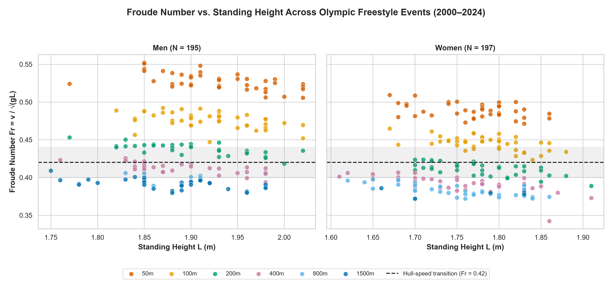
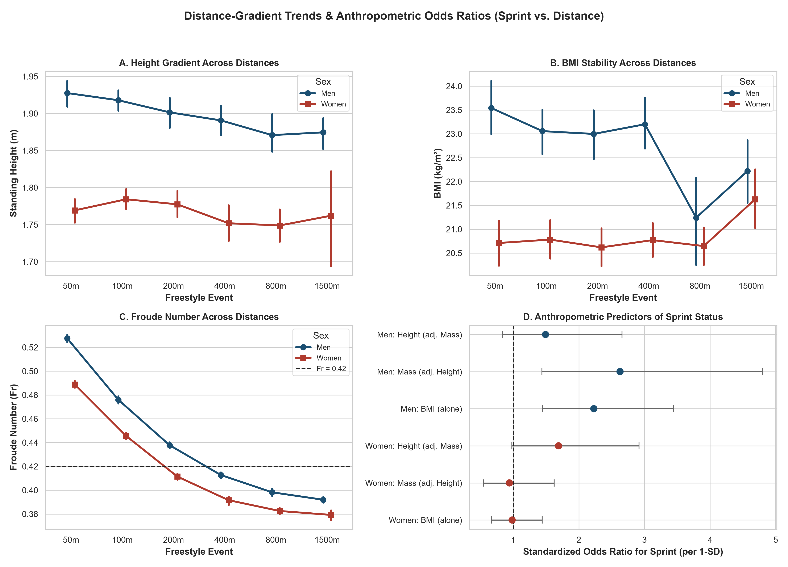
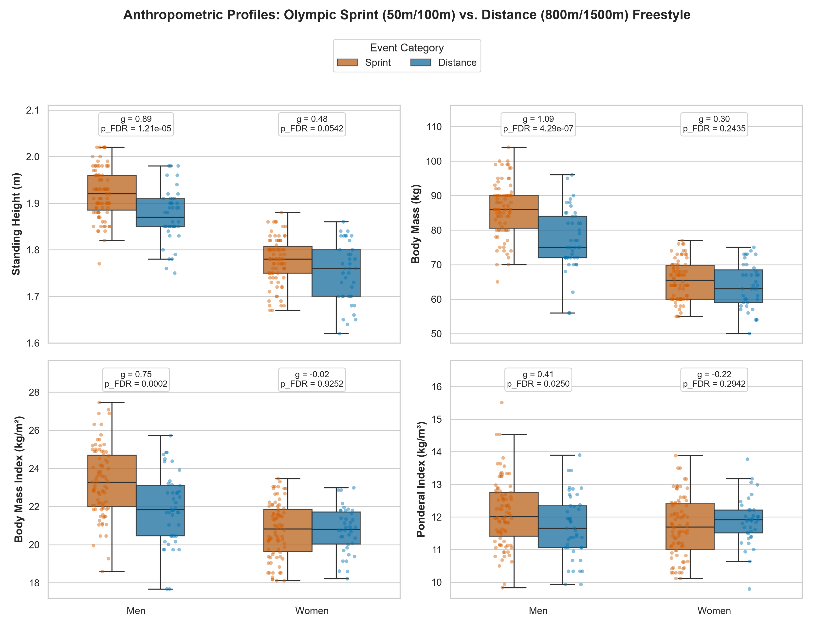
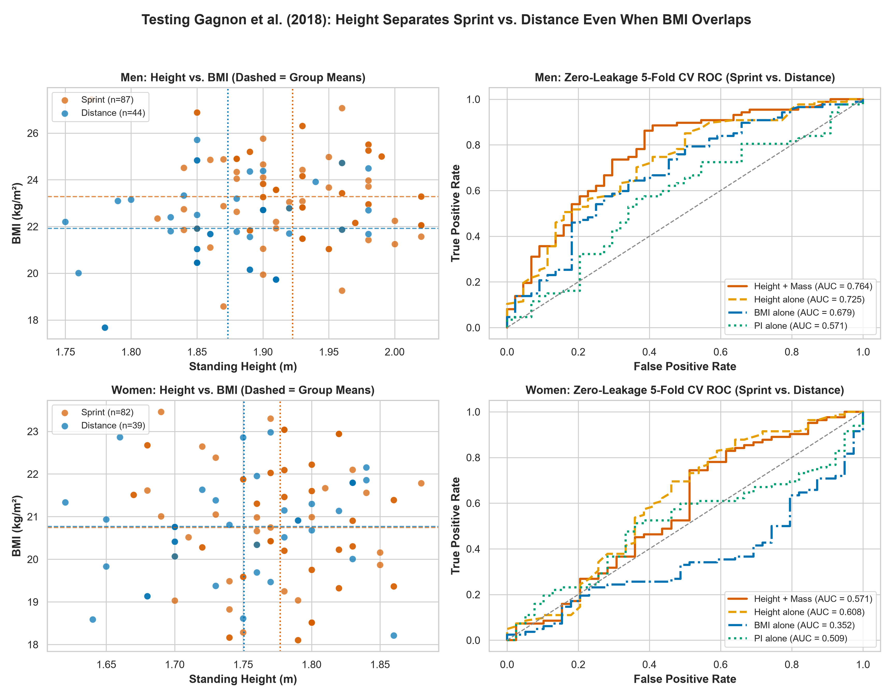
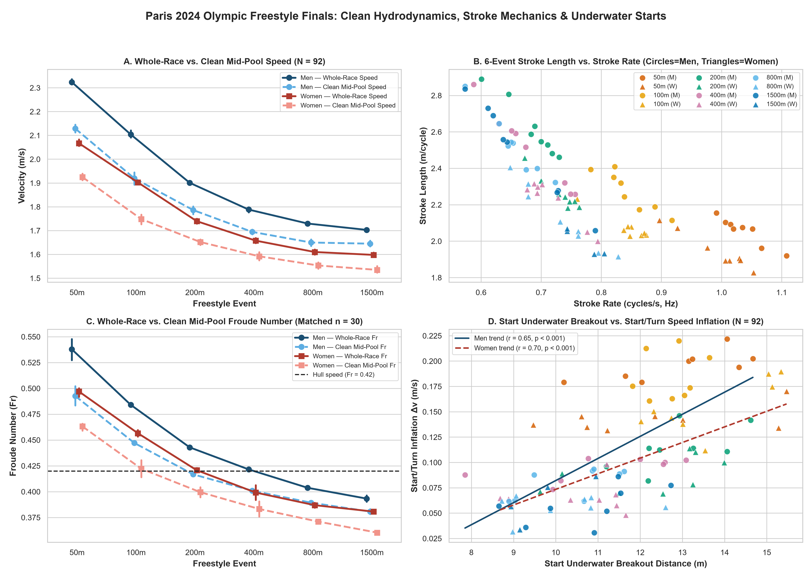

# The Physics of Swimming Performance: Olympic Freestyle Hydrodynamics & Stroke Kinematics (2000–2024)

Empirical hydrodynamic, anthropometric, and stroke-kinematics analysis of Olympic Freestyle swimming across all six individual events (`50m`, `100m`, `200m`, `400m`, `800m`, `1500m`) from the 2000–2024 Olympic Games, paired with an official Paris 2024 Finals stroke kinematics sub-study ($N = 92$ finalists from the FFN race-analysis booklet).

## Key Findings
- **Pinpointing the $Fr = 0.42$ Hull-Speed Transition (6 Events, $N = 392$):** **100.0%** of Olympic sprinters (`50m`/`100m`, both sexes) operated above the theoretical wave-drag hull-speed transition ($Fr = 0.42$), whereas **0.0%** of distance swimmers (`800m`/`1500m`) exceeded it ($g = 4.54$ Men, $g = 4.20$ Women, $p_{\text{FDR}} < 10^{-52}$). Extending to `200m`/`400m` shows whole-race $Fr$ crosses $0.42$ between `200m` (97.0%) and `400m` (19.4%) in Men, and between `100m` (100.0%) and `200m` (15.8%) in Women.


- **Women (Gagnon et al., 2018 Replication):** Sprint women are significantly taller than Distance women ($1.777 \pm 0.049\text{ m}$ vs. $1.751 \pm 0.065\text{ m}$, $g = 0.48$, $p_{\text{FDR}} = 0.0488$), while BMI is virtually identical ($20.75$ vs. $20.77\text{ kg/m}^2$, $g = -0.02$, $p_{\text{FDR}} = 0.925$). Zero-leakage 5-fold CV logistic regression: `Height alone` AUC = `0.608` ($\text{OR} = 1.62$/SD) vs. `BMI alone` AUC = `0.352` ($\text{OR} = 0.98$).
- **Men (Height + Anaerobic Power Scaling):** Sprint men are taller ($1.922$ vs. $1.873\text{ m}$, $g = 0.89$), heavier ($86.09$ vs. $77.14\text{ kg}$, $g = 1.09$), and higher in BMI ($g = 0.75$). `Height + Mass` achieves 5-fold CV AUC = `0.764` (76.3% accuracy) vs. `BMI alone` (`0.679`).


- **Paris 2024 Clean Mid-Pool Hydrodynamics ($N = 92$ FFN Finalists; $n = 30$ Matched Anthropometrics):** Removing dive-start and turn push-off inflation (`+0.191 m/s` Men Sprint, `+0.143 m/s` Women Sprint) confirms that **100.0% (7/7) of Men sprinters** (clean $Fr = 0.486$) and **85.7% (6/7) of Women sprinters** (clean $Fr = 0.440$) remain supercritical during clean surface swimming—whereas **0/8 (0.0%) Men's 200m finalists** exceed $Fr = 0.42$ at the historical 200m mean height ($1.902\text{ m}$, clean $Fr = 0.4135$).
- **Stroke Mechanics & Underwater Starts:** Across all 6 events, log-space variance decomposition shows Stroke Rate variance is **3.0–3.1×** larger than Stroke Length variance. Longer start underwater breakouts (`Sortie de coulée`) strongly drive start/turn velocity inflation in both Men ($r = 0.650, p = 5.87 \times 10^{-7}$) and Women ($r = 0.696, p = 1.57 \times 10^{-7}$).

## Repository Structure
- [PROJECT SUMMARY.md](Sprint%20vs.%20Distance%20Freestyle%20Physics_%20Research%20%26%20Data%20Roadmap%20-%20PROJECT%20SUMMARY.md) — Research roadmap, hydrodynamic equations, confounder controls, and data sources.
- [scripts/clean_and_merge.py](scripts/clean_and_merge.py) — Merges Olympedia/Kaggle bios with 2000–2024 Olympic freestyle results (6 events), computes derived physics metrics (`Fr`, 26 °C `Re`, `v_hull`, World Aquatics Points), preserves `is_finalist` via logical OR, and validates physical bounds.
- [scripts/statistical_analysis.py](scripts/statistical_analysis.py) — Runs sex-stratified Sprint vs. Distance comparisons, 7 sensitivity splits (including `is_finalist == True` and `2000_2020_only`), 6-event gradient tests, parsimonious OLS (`max VIF = 4.20`), zero-leakage 5-fold CV logistic regression, and generates 4 figures.
- [scripts/extract_paris2024_splits.py](scripts/extract_paris2024_splits.py) & [scripts/extract_ffn_kinematics.py](scripts/extract_ffn_kinematics.py) — Extracts official Paris 2024 lanes, reaction times, 50m splits, and FFN steady-state mid-pool kinematics.
- [scripts/validate_kinematics.py](scripts/validate_kinematics.py) & [scripts/kinematics_analysis.py](scripts/kinematics_analysis.py) — Audits kinematics bounds/consistency ($\text{ICC}(2,1) = 0.9978$) and runs non-tautological log-variance decomposition, paired Froude tests, and start/underwater analyses.
- [scripts/kinematics_tagger.html](scripts/kinematics_tagger.html) — Standalone local browser tagging tool for manual video verification.
- [data/processed/](data/processed/) — Cleaned 6-event datasets (`swimming_athlete_event_clean.csv`, `swimming_results_clean.csv`) and [data_validation_report.md](data/processed/data_validation_report.md).
- [data/raw/world_aquatics_base_times.json](data/raw/world_aquatics_base_times.json) — Official 2025 World Aquatics LCM Freestyle base times (all 12 events). *(Large raw CSVs and official PDFs are excluded via `.gitignore`.)*
- [results/](results/) — [statistical_analysis_report.md](results/statistical_analysis_report.md), [kinematics_report.md](results/kinematics_report.md), summary CSV tables, and publication-quality figures in `results/figures/`.

## Quickstart
```bash
python -m venv .venv
.venv\Scripts\activate   # or: source .venv/bin/activate
pip install -r requirements.txt
python scripts/statistical_analysis.py
python scripts/kinematics_analysis.py
```
