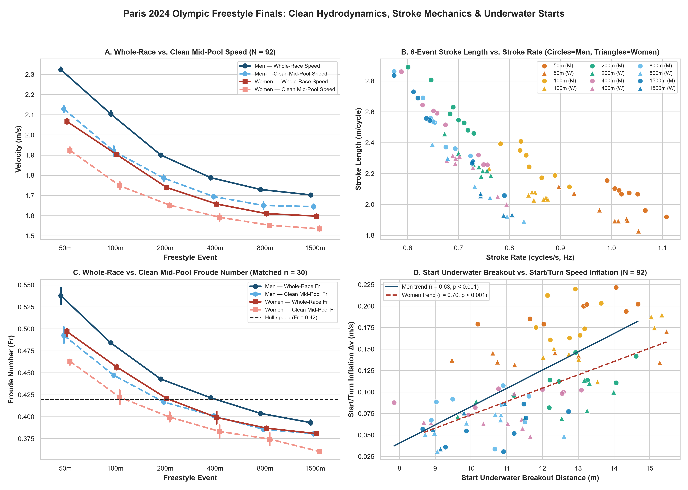

# Paris 2024 Olympic Freestyle Finals: Stroke Kinematics & Clean Mid-Pool Hydrodynamics Report

## 1. Data Source, Coverage & Quality Audit

Official steady-state mid-pool section times, stroke rates, stroke lengths, and underwater start breakout distances were extracted from the French Swimming Federation's official post-Games biomechanics compilation (*Fédération Française de Natation*, [Livret analyses finales JO Paris 2024.pdf](../data/raw/Livret%20analyses%20finales%20JO%20Paris%202024.pdf)) via [extract_ffn_kinematics.py](../scripts/extract_ffn_kinematics.py) into [paris2024_kinematics.csv](../data/raw/paris2024_kinematics.csv), and merged with official block reaction times from [paris2024_official_splits.csv](../data/raw/paris2024_official_splits.csv) (extracted from [OG2024_SWM_B99_SWM.pdf](../data/raw/OG2024_SWM_B99_SWM.pdf)).

* **Coverage:** **92 of 96** Paris 2024 Olympic Freestyle finalists across all 12 finals:
  * **11 of 12 finals (8/8 complete):** All 6 Men's finals ($n = 48$) and Women's 50m, 100m, 200m, 400m, and 800m ($n = 40$).
  * **Women's 1500m Freestyle (4/8):** The FFN booklet reports Ranks 1–4 (Katie Ledecky, Anastasiia Kirpichnikova, Isabel Gose, Simona Quadarella); Ranks 5–8 (Li Bingjie, Moesha Johnson, Beatriz Dizotti, Leonie Märtens) are omitted by the FFN PDF and strictly retained as `NaN` without imputation.
  * **Tier 2 Matched Anthropometric-Kinematics Cohort:** **30 of 31** returning Olympians with verified `height_m` and `mass_kg` (**22 unique athletes** across 30 finalist rows: 14 Men [13 unique athletes], 16 Women [9 unique athletes, including multi-event finalists Katie Ledecky and Erika Fairweather]).
* **Standardized Steady-State Mid-Pool Windows:**
  * `50m`: Lap 1 `15–45m` (`30.0 m`) · `100m`: Lap 2 `65–95m` (`30.0 m`) · `200m`: Lap 3 `115–145m` (`30.0 m`)
  * `400m`: Lap 4 `155–195m` (`40.0 m`) · `800m`: Lap 7 `305–345m` (`40.0 m`, aligned to FFN's odd-lap `300–350m` SR/SL row) · `1500m`: Lap 15 `705–745m` (`40.0 m`)
* **Phase 3 Audit ([validate_kinematics.py](../scripts/validate_kinematics.py)):**
  * **0** duplicate swimmers; **0** physical-bound flags across all 92 rows (`clean_velocity_ms` $\in [1.520, 2.174]\text{ m/s}$, `stroke_rate_hz` $\in [0.573, 1.108]\text{ Hz}$, `stroke_length_m` $\in [1.827, 2.890]\text{ m/cycle}$, `start_turn_inflation_ms` $\in [+0.031, +0.222]\text{ m/s}$).
  * **Internal Consistency:** Derived clean stroke length ($v_{\text{clean}} / SR$) matches FFN's directly reported lap stroke length with **$\text{MAE} = 0.0097\text{ m/cycle}$** (`0.0035 m/cycle` in Men's 800m, `0.0055 m/cycle` in Women's 800m), Pearson $r = 0.99937$ ($p = 2.58 \times 10^{-132}$), and **$\text{ICC}(2,1) = 0.99871$**.

---

## 2. Dive/Turn Inflation, Clean Mid-Pool Froude Transition & Men's 200m Robustness Check

Removing the dive start (8–15 m underwater breakout) and wall push-offs reduces apparent race speed and Froude number in every category (paired $t$-tests $p \le 0.006$ in all cells except the small $n = 3$ Women's Distance cell, $p = 0.060$; full results in [kinematics_models.csv](kinematics_models.csv)).

### Paired Whole-Race vs. Clean Mid-Pool Froude Number (Matched Cohort, $n = 30$ rows / 22 unique athletes)
| Sex | Scope | $n$ | Whole-Race $Fr$ | Clean Mid-Pool $Fr$ | $\Delta Fr$ Inflation | $\Delta v$ Inflation (m/s) | Paired $t$ ($p$) | Whole $Fr > 0.42$ | **Clean $Fr > 0.42$** |
| :--- | :--- | :---: | :---: | :---: | :---: | :---: | :---: | :---: | :---: |
| **Men** | All Matched | 14 | $0.472$ | $0.441$ | $+0.032$ | $+0.137$ | $8.53$ ($1.10 \times 10^{-6}$) | 71.4% | **50.0%** |
| **Men** | **Sprint (50m/100m)** | 7 | $0.530$ | **$0.486$** | $+0.044$ | $+0.191$ | $24.67$ ($2.92 \times 10^{-7}$) | 100.0% | **100.0%** |
| **Men** | Middle (200m/400m) | 3 | $0.436$ | $0.411$ | $+0.024$ | $+0.104$ | $12.95$ ($0.0059$) | 100.0% | **0.0%** |
| **Men** | Distance (800m/1500m) | 4 | $0.398$ | $0.383$ | $+0.015$ | $+0.066$ | $7.93$ ($0.0042$) | 0.0% | **0.0%** |
| **Women** | All Matched | 16 | $0.435$ | $0.409$ | $+0.025$ | $+0.104$ | $10.42$ ($2.89 \times 10^{-8}$) | 56.2% | **37.5%** |
| **Women** | **Sprint (50m/100m)** | 7 | $0.474$ | **$0.440$** | $+0.034$ | $+0.143$ | $20.66$ ($8.37 \times 10^{-7}$) | 100.0% | **85.7%** |
| **Women** | Middle (200m/400m) | 6 | $0.413$ | $0.394$ | $+0.019$ | $+0.080$ | $10.01$ ($0.0002$) | 33.3% | **0.0%** |
| **Women** | Distance (800m/1500m) | 3 | $0.385$ | $0.370$ | $+0.015$ | $+0.063$ | $3.90$ ($0.0600$) | 0.0% | **0.0%** |

### Men's 200m Clean Froude Robustness Check (All 8 Finalists)
Because Tier 2 only has $n = 2$ matched Men's 200m finalists (both dropping from whole-race $Fr = 0.443$ to clean $Fr = 0.417$), we verified the hull-speed transition across **all 8 Men's 200m finalists** (`clean_velocity_ms` $= 1.786 \pm 0.025\text{ m/s}$) across three representative heights:

| Assumed Standing Height ($L$) | Mean Clean $Fr$ ± SD | Range [Min, Max] | Finalists $> 0.42$ |
| :--- | :---: | :---: | :---: |
| **$L = 1.850\text{ m}$ (lower bound)** | $0.4192 \pm 0.0060$ | $[0.4075,\ 0.4255]$ | 4 / 8 (50.0%) |
| **$L = 1.902\text{ m}$ (historical Men's 200m Olympic mean)** | **$0.4135 \pm 0.0059$** | $[0.4019,\ 0.4196]$ | **0 / 8 (0.0%)** |
| **$L = 1.950\text{ m}$ (upper bound)** | **$0.4084 \pm 0.0058$** | $[0.3969,\ 0.4144]$ | **0 / 8 (0.0%)** |

**Hydrodynamic Conclusion:** Even after stripping `+0.191 m/s` (Men) and `+0.143 m/s` (Women) of dive-start/turn inflation, **100.0% (7/7) of Men sprinters** and **85.7% (6/7) of Women sprinters** remain genuinely supercritical ($Fr > 0.42$) during clean mid-pool swimming. Conversely, across all 8 Men's 200m finalists at the historical 200m mean height ($1.902\text{ m}$), **0/8 (0.0%)** exceed $Fr = 0.42$ during clean mid-pool swimming—confirming that Men's 200m whole-race $Fr > 0.42$ is driven by dive-start and turn-pushoff inflation, and **true clean-swimming supercriticality is strictly a 50m/100m Sprint phenomenon in both sexes.**

---

## 3. Event Gradient Across All 6 Events ($N = 92$: 50m → 1500m)

Full event-level means, SDs, and medians are saved in [kinematics_summary.csv](kinematics_summary.csv).

### Men ($N = 48$ across 6 Finals)
| Event | $n$ | Whole $v$ (m/s) | Clean $v$ (m/s) | Inflation $\Delta v$ (m/s) | Underwater Start (m) | Reaction Time (s) | Stroke Rate (Hz) | Stroke Length (m/cyc) | Stroke Index ($\text{m}^2/\text{s}$) |
| :--- | :---: | :---: | :---: | :---: | :---: | :---: | :---: | :---: | :---: |
| **50m Freestyle** | 8 | $2.324$ | $2.128$ | $+0.195$ | $12.92$ | $0.621$ | $1.037$ | $2.055$ | $4.374$ |
| **100m Freestyle** | 8 | $2.104$ | $1.919$ | $+0.184$ | $12.72$ | $0.653$ | $0.846$ | $2.274$ | $4.365$ |
| **200m Freestyle** | 8 | $1.901$ | $1.786$ | $+0.115$ | $12.87$ | $0.678$ | $0.685$ | **$2.616$** | **$4.672$** |
| **400m Freestyle** | 8 | $1.788$ | $1.694$ | $+0.094$ | $11.11$ | $0.666$ | $0.681$ | $2.507$ | $4.245$ |
| **800m Freestyle** | 8 | $1.729$ | $1.650$ | $+0.079$ | $10.37$ | $0.710$ | $0.655$ | $2.528$ | $4.174$ |
| **1500m Freestyle** | 8 | $1.703$ | $1.645$ | $+0.058$ | $10.71$ | $0.741$ | $0.666$ | $2.495$ | $4.105$ |

### Women ($N = 44$ across 6 Finals; 1500m Ranks 1–4)
| Event | $n$ | Whole $v$ (m/s) | Clean $v$ (m/s) | Inflation $\Delta v$ (m/s) | Underwater Start (m) | Reaction Time (s) | Stroke Rate (Hz) | Stroke Length (m/cyc) | Stroke Index ($\text{m}^2/\text{s}$) |
| :--- | :---: | :---: | :---: | :---: | :---: | :---: | :---: | :---: | :---: |
| **50m Freestyle** | 8 | $2.067$ | $1.925$ | $+0.142$ | $12.27$ | $0.676$ | $0.992$ | $1.945$ | **$3.742$** |
| **100m Freestyle** | 8 | $1.902$ | $1.748$ | $+0.154$ | $13.64$ | $0.684$ | $0.844$ | $2.073$ | $3.623$ |
| **200m Freestyle** | 8 | $1.739$ | $1.652$ | $+0.088$ | $12.19$ | $0.702$ | $0.732$ | **$2.261$** | $3.735$ |
| **400m Freestyle** | 8 | $1.658$ | $1.592$ | $+0.066$ | $10.58$ | $0.731$ | $0.719$ | $2.220$ | $3.533$ |
| **800m Freestyle** | 8 | $1.610$ | $1.552$ | $+0.058$ | $10.20$ | $0.731$ | $0.735$ | $2.124$ | $3.298$ |
| **1500m Freestyle** | 4 | $1.598$ | $1.535$ | $+0.063$ | $9.71$ | $0.728$ | $0.770$ | $1.995$ | $3.062$ |

---

## 4. Non-Tautological Biomechanical Decompositions & Mechanisms

### A. Log-Space Variance Decomposition: $\text{Var}(\ln v_{\text{clean}}) = \text{Var}(\ln SL) + \text{Var}(\ln SR) + 2\,\text{Cov}(\ln SL, \ln SR)$
Because $v_{\text{clean}} = SL \times SR$ is an exact multiplicative identity, taking logs yields an exact additive variance decomposition without circular regression:

| Sex | Scope | $n$ | $\text{Var}(\ln SR)$ (% of $\text{Var}(\ln v)$) | $\text{Var}(\ln SL)$ (% of $\text{Var}(\ln v)$) | $2\,\text{Cov}(\ln SL, \ln SR)$ (%) | Interpretation |
| :--- | :--- | :---: | :---: | :---: | :---: | :--- |
| **Men** | **All 6 Events** | 48 | **380.4%** | **128.3%** | $-408.6\%$ | $SR$ variance is **3.0×** $SL$ variance; strong $SL$–$SR$ trade-off |
| **Men** | Sprint (50m/100m) | 16 | 414.8% | 144.1% | $-458.8\%$ | Speed jump from 100m→50m driven primarily by $SR$ |
| **Men** | Middle (200m/400m) | 16 | 663.8% | 623.6% | $-1187.3\%$ | Balanced individual $SR$/$SL$ trade-off |
| **Men** | Distance (800m/1500m) | 16 | 4071.2% | 4270.6% | $-8241.8\%$ | Equal $SR$ & $SL$ variation cancelling 1:1 at nearly constant cruise speed |
| **Women** | **All 6 Events** | 44 | **269.7%** | **88.2%** | $-257.9\%$ | $SR$ variance is **3.1×** $SL$ variance; strong $SL$–$SR$ trade-off |
| **Women** | Sprint (50m/100m) | 16 | 346.7% | 101.8% | $-348.5\%$ | Speed jump from 100m→50m driven primarily by $SR$ |
| **Women** | Middle (200m/400m) | 16 | 464.6% | 427.1% | $-791.7\%$ | Balanced individual $SR$/$SL$ trade-off |
| **Women** | Distance (800m/1500m) | 12 | 6058.9% | 6422.9% | $-12381.8\%$ | Diverse $SR$/$SL$ styles yielding nearly identical cruise speeds |

* Across all 6 events, **Stroke Rate variance is 3.0–3.1× larger than Stroke Length variance** in both sexes (matching the strong positive `SR`–`v_clean` correlation: Men $r = 0.920, p = 2.54 \times 10^{-20}$; Women $r = 0.877, p = 5.47 \times 10^{-15}$). Within Distance events (800m/1500m), finalists swim at tightly clustered cruise velocities ($\text{SD} \approx 0.02\text{ m/s}$), so large individual differences in $SR$ and $SL$ cancel nearly 1-for-1 through negative covariance.

### B. Anthropometrics → Stroke Mechanics (Tier 2, $n = 30$ rows / 22 unique athletes, Controlling for $\ln(\text{Distance})$)
Testing separately whether `height_m` and `mass_kg` predict `stroke_length_m` or `stroke_rate_hz` after adjusting for $\ln(\text{distance\_m})$:

| Sex | Model | $n$ | $R^2$ | Height $\beta$ ($p$) | Mass $\beta$ ($p$) |
| :--- | :--- | :---: | :---: | :---: | :---: |
| **Men** | `Height + Mass + ln(Dist) -> stroke_length_m` | 14 | $0.589$ | $+0.096$ ($p = 0.719$) | $-0.193$ ($p = 0.534$) |
| **Men** | `Height + Mass + ln(Dist) -> stroke_rate_hz` | 14 | $0.848$ | $-0.021$ ($p = 0.895$) | $+0.074$ ($p = 0.693$) |
| **Women** | `Height + Mass + ln(Dist) -> stroke_length_m` | 16 | $0.626$ | $-0.488$ ($p = 0.111$) | $-0.106$ ($p = 0.717$) |
| **Women** | `Height + Mass + ln(Dist) -> stroke_rate_hz` | 16 | $0.774$ | $+0.288$ ($p = 0.217$) | $+0.064$ ($p = 0.777$) |

* Once race distance ($\ln(\text{distance\_m})$) is controlled, `height_m` and `mass_kg` do not reach statistical significance in predicting $SL$ or $SR$ within this small matched subsample ($n = 14$ Men [13 unique], $n = 16$ Women [9 unique]; all $p \ge 0.111$), indicating that race distance and individual technical/neuromuscular style account for the bulk of stroke-parameter variance among Olympic finalists.

### C. Start & Underwater Breakout Mechanics (All 92 Finalists)
Merging official reaction times (`OG2024_SWM_B99_SWM.pdf`) with FFN's official start underwater breakout distances (`Sortie de coulée`):

| Sex | Predictor | Outcome | $n$ | Pearson $r$ ($p$) | Spearman $\rho$ |
| :--- | :--- | :--- | :---: | :---: | :---: |
| **Men** | `underwater_start_m` | `start_turn_inflation_ms` | 48 | **$+0.628$** ($1.75 \times 10^{-6}$) | $+0.690$ |
| **Men** | `underwater_start_m` | `whole_race_velocity_ms` | 48 | **$+0.548$** ($5.60 \times 10^{-5}$) | $+0.615$ |
| **Men** | `reaction_time_sec` | `start_turn_inflation_ms` | 48 | **$-0.700$** ($3.00 \times 10^{-8}$) | $-0.720$ |
| **Men** | `reaction_time_sec` | `whole_race_velocity_ms` | 48 | **$-0.648$** ($6.30 \times 10^{-7}$) | $-0.672$ |
| **Women** | `underwater_start_m` | `start_turn_inflation_ms` | 44 | **$+0.701$** ($1.15 \times 10^{-7}$) | $+0.629$ |
| **Women** | `underwater_start_m` | `whole_race_velocity_ms` | 44 | **$+0.523$** ($0.0003$) | $+0.576$ |
| **Women** | `reaction_time_sec` | `start_turn_inflation_ms` | 44 | **$-0.539$** ($0.0002$) | $-0.583$ |
| **Women** | `reaction_time_sec` | `whole_race_velocity_ms` | 44 | **$-0.562$** ($7.10 \times 10^{-5}$) | $-0.600$ |

* **Physical Mechanism:** Longer submerged underwater breakouts (where wave-making drag is eliminated below ~0.7 m depth; Men 50m–200m mean `12.7–12.9 m` vs. 800m–1500m `10.4–10.7 m`; Women 50m–200m `12.2–13.6 m` vs. 800m–1500m `9.7–10.2 m`) and faster block reaction times directly drive the larger whole-race vs. clean-swimming velocity inflation in shorter events ($r = 0.63$–$0.70, p < 2 \times 10^{-6}$).

