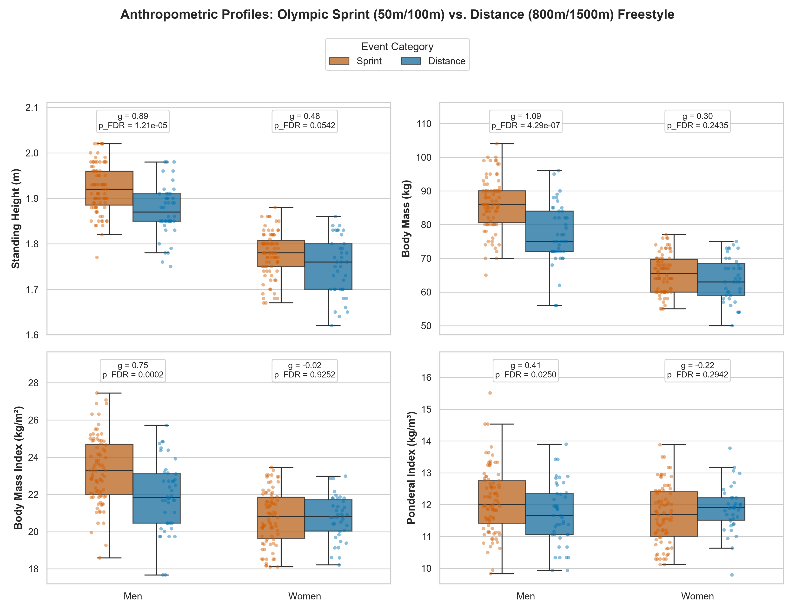
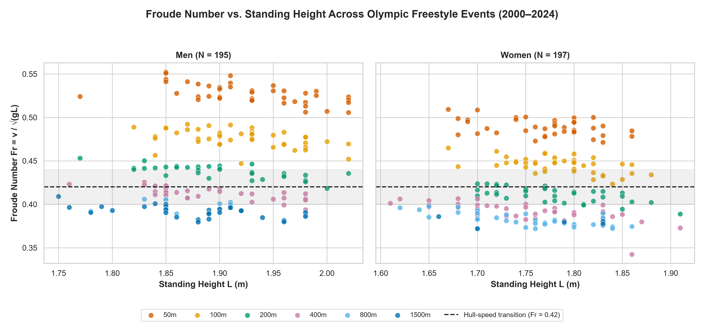
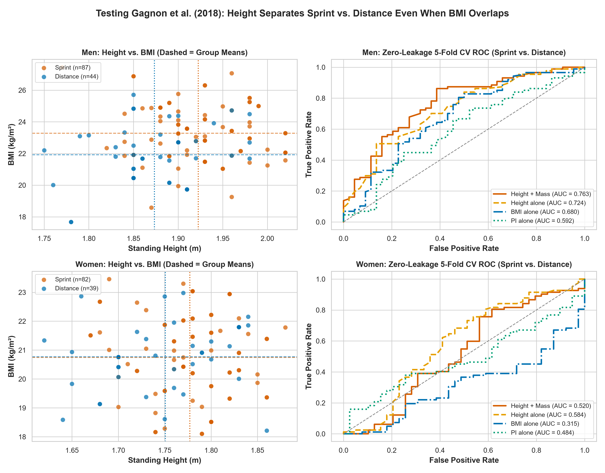
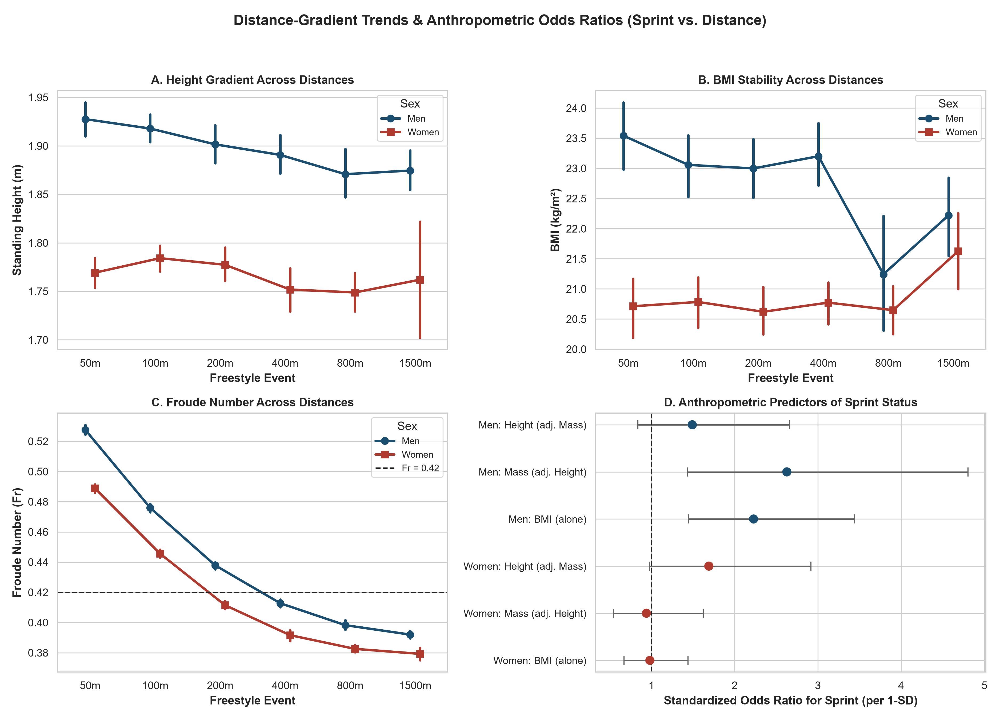

# Statistical Analysis Report: Hydrodynamic & Anthropometric Constraints in Olympic Freestyle Swimming (2000–2024)

## 1. Executive Summary

Using the cleaned, `athlete_key`-deduplicated 6-event Olympic freestyle dataset ([swimming_athlete_event_clean.csv](../data/processed/swimming_athlete_event_clean.csv); **N = 392** athlete-event rows across **268** unique athletes: 195 Men [139 unique], 197 Women [129 unique]; **340** finalists and **52** non-finalists) and the full multi-Games dataset ([swimming_results_clean.csv](../data/processed/swimming_results_clean.csv); **N = 491** rows) for cluster-robust sensitivity checks, we tested the hydrodynamic and anthropometric hypotheses across **Sprint** (50m/100m), **Middle** (200m/400m), and **Distance** (800m/1500m) freestyle. Primary pairwise Sprint vs. Distance comparisons and zero-leakage classification models strictly use the **N = 252** Sprint+Distance subset (200 unique athletes: 131 Men [106 unique], 121 Women [94 unique]), while distance-gradient and hull-speed transition analyses span all 6 events.

**Physical Constants (World Aquatics Competition Pool Temperature: 26 °C):**
- Gravitational acceleration: $g = 9.81\text{ m/s}^2$
- Water density (26 °C): $\rho = 996.8\text{ kg/m}^3$
- Dynamic viscosity (26 °C): $\mu = 8.7 \times 10^{-4}\text{ Pa}\cdot\text{s}$
- Reynolds number: $Re = \rho v L / \mu$; Froude number: $Fr = v / \sqrt{gL}$; Theoretical hull speed: $v_{\text{hull}} = 0.42\sqrt{gL}$.

**Key Findings:**
1. **Pinpointing the $Fr = 0.42$ Hull-Speed Regime Transition Across All 6 Events:** Every single Olympic sprinter (100.0% of 50m and 100m swimmers in both Men and Women) operated above the theoretical wave-drag hull-speed transition ($Fr = 0.42$), whereas **0.0%** of distance swimmers (800m and 1500m in both sexes) exceeded $Fr = 0.42$ ($g = 4.54$ in Men, $g = 4.20$ in Women, $p_{\text{FDR}} < 10^{-52}$). Extending the dataset to 200m and 400m freestyle pinpoints the exact sex-specific transition:
   - **Men** cross $Fr = 0.42$ between **200m** (97.0% $> 0.42$; mean $Fr = 0.438 \pm 0.007$) and **400m** (19.4% $> 0.42$; mean $Fr = 0.413 \pm 0.007$).
   - **Women** cross $Fr = 0.42$ one distance step shorter, between **100m** (100.0% $> 0.42$; mean $Fr = 0.446 \pm 0.009$) and **200m** (15.8% $> 0.42$; mean $Fr = 0.411 \pm 0.008$), with 0.0% exceeding $Fr = 0.42$ in 400m, 800m, and 1500m.
2. **Direct Replication of Gagnon et al. (2018) in Women—Height Separates Where BMI Converges:** Among Women, Sprint swimmers were taller than Distance swimmers ($1.777 \pm 0.049\text{ m}$ vs. $1.751 \pm 0.065\text{ m}$; Hedges' $g = 0.48$, 95% CI $[0.10, 0.87]$, raw Welch $p = 0.0271$, 8-metric $p_{\text{FDR}} = 0.0542$; strengthening to $g = 0.59, p_{\text{FDR}} = 0.0189$ when excluding 50m), whereas **BMI was virtually identical** ($20.75 \pm 1.45$ vs. $20.77 \pm 1.18\text{ kg/m}^2$; $g = -0.02$, $p_{\text{FDR}} = 0.9252$). In athlete-grouped zero-leakage 5-fold CV logistic regression (`StratifiedGroupKFold`), `BMI alone` failed ($\text{AUC} = 0.315$, $\text{OR} = 0.98$), while `Height alone` achieved $\text{AUC} = 0.584$ ($\text{OR} = 1.62$ per SD).
3. **Divergent Sex Scaling in Men—Both Height and Muscle Mass Drive Sprint Specialization:** Among Men, Sprint swimmers were significantly taller ($1.922 \pm 0.054\text{ m}$ vs. $1.873 \pm 0.056\text{ m}$; $g = 0.89$, $p_{\text{FDR}} = 1.21 \times 10^{-5}$), heavier ($86.09 \pm 7.75\text{ kg}$ vs. $77.14 \pm 8.85\text{ kg}$; $g = 1.09$, $p_{\text{FDR}} = 4.29 \times 10^{-7}$), and had higher BMI ($23.29 \pm 1.78$ vs. $21.93 \pm 1.85\text{ kg/m}^2$; $g = 0.75$, $p_{\text{FDR}} = 0.0002$) and Ponderal Index ($g = 0.41$, $p_{\text{FDR}} = 0.0250$). `Height + Mass` achieved athlete-grouped 5-fold CV $\text{AUC} = 0.763$ (76.3% accuracy), outperforming `BMI alone` ($\text{AUC} = 0.680$).
4. **Within-Category Physics:** Within Distance swimming (800m/1500m), taller athletes swam faster and scored higher World Aquatics Points in both Men ($r = 0.364$, $p = 0.015$ for velocity; $r = 0.397$, $p = 0.008$ for WA Points) and Women ($r = 0.396$, $p = 0.013$ for velocity; $r = 0.413$, $p = 0.009$ for WA Points), while maintaining significantly lower Froude numbers ($r = -0.478$ in Men, $r = -0.627$ in Women). Taller middle-distance swimmers also operated at lower Froude numbers in both Men ($r = -0.278$, $p = 0.026$) and Women ($r = -0.321$, $p = 0.005$).

---

## 2. Sample Structure, Overlap & Structural Asymmetries

* **Deduplicated Athlete-Event Dataset (`swimming_athlete_event_clean.csv`):** 392 rows across 6 events, **0% missingness** on all 21 core analysis columns (including `is_finalist`, anthropometric variables, and 26 °C hydrodynamic variables).
  * **Men (N = 195 rows, 139 unique athletes across 6 events):** Sprint = 87 (50m: 41, 100m: 46); Middle = 64 (200m: 33, 400m: 31); Distance = 44 (800m: 13, 1500m: 31). Within Sprint+Distance ($N = 131$, 106 unique), **16** male athletes appear in both 50m and 100m; **1** appears in both Sprint and Distance.
  * **Women (N = 197 rows, 129 unique athletes across 6 events):** Sprint = 82 (50m: 39, 100m: 43); Middle = 76 (200m: 38, 400m: 38); Distance = 39 (800m: 34, 1500m: 5). Within Sprint+Distance ($N = 121$, 94 unique), **23** female athletes appear in both 50m and 100m; **0** appear in both Sprint and Distance.
* **Tokyo 2020 Event-Introduction Asymmetry:** Men's 800m Freestyle ($n = 13$) and Women's 1500m Freestyle ($n = 5$) debuted at Tokyo 2020 (held 2021), creating smaller sample sizes for those two cells compared with Men's 1500m ($n = 31$) and Women's 800m ($n = 34$).
* **Paris 2024 Stage & `is_finalist` Recovery:** 2000–2020 data (`kaggle_1912_2020`) represent finalists (all `is_finalist = True`), whereas Paris 2024 includes all heats/semis/finals. Using logical OR (`max`) aggregation of `is_finalist` before deduplicating to fastest time recovers **7** Paris 2024 finalists whose fastest swim occurred in a Heat or Semifinal (raising Sprint+Distance `finalists_only` from $N = 200$ to **$N = 207$**). We additionally include a **`2000_2020_only`** sensitivity split ($N = 185$) to confirm Paris 2024 returning-Olympian coverage does not bias Sprint vs. Distance inferences.

---

## 3. Primary Sprint vs. Distance Comparisons (Sex-Stratified)

All comparisons strictly filter to `event_category ∈ {"Sprint", "Distance"}` (`50m/100m` vs. `800m/1500m`) and use Welch's two-sample t-test, Mann-Whitney U test, Hedges' $g$ (95% CI), rank-biserial $r$, and Benjamini-Hochberg FDR adjustment across the **8 unique metrics** within each sex (`froude_hull_ratio` is retained for reference as an exact linear rescaling of $Fr / 0.42$ and excluded from the FDR family; full table in [sprint_vs_distance_comparisons.csv](sprint_vs_distance_comparisons.csv)). For additional transparency, the **4-metric anthropometric-only BH-FDR** (`height_m`, `mass_kg`, `bmi`, `ponderal_index`) yields Men Height $p_{\text{FDR,4}} = 1.51 \times 10^{-5}$, Mass $8.58 \times 10^{-7}$, BMI $0.0002$, PI $0.0250$; and Women Height $p_{\text{FDR,4}} = 0.1084$ (raw Welch $p = 0.0271$, $g = 0.48$ $[0.10, 0.87]$), Mass $0.2942$, BMI $0.9252$, PI $0.2942$.

### Men (Sprint $n = 87$ vs. Distance $n = 44$)
| Metric | Sprint (Mean ± SD) | Distance (Mean ± SD) | Hedges' $g$ [95% CI] | Rank-Biserial $r$ | Welch $p_{\text{FDR}}$ | MWU $p_{\text{FDR}}$ |
| :--- | :---: | :---: | :---: | :---: | :---: | :---: |
| **Height (m)** | $1.922 \pm 0.054$ | $1.873 \pm 0.056$ | $0.89$ $[0.51, 1.27]$ | $0.46$ | $1.21 \times 10^{-5}$ | $2.34 \times 10^{-5}$ |
| **Body Mass (kg)** | $86.09 \pm 7.75$ | $77.14 \pm 8.85$ | $1.09$ $[0.71, 1.48]$ | $0.56$ | $4.29 \times 10^{-7}$ | $3.09 \times 10^{-7}$ |
| **BMI (kg/m²)** | $23.29 \pm 1.78$ | $21.93 \pm 1.85$ | $0.75$ $[0.37, 1.12]$ | $0.41$ | $0.0002$ | $0.0002$ |
| **Ponderal Index (kg/m³)** | $12.12 \pm 1.02$ | $11.71 \pm 0.97$ | $0.41$ $[0.05, 0.78]$ | $0.22$ | $0.0250$ | $0.0441$ |
| **Mean Race Speed (m/s)** | $2.172 \pm 0.122$ | $1.688 \pm 0.029$ | $4.76$ $[4.08, 5.44]$ | $1.00$ | $1.88 \times 10^{-58}$ | $2.96 \times 10^{-20}$ |
| **Froude Number ($Fr$)** | $0.500 \pm 0.028$ | $0.394 \pm 0.007$ | $4.54$ $[3.88, 5.20]$ | $1.00$ | $1.90 \times 10^{-57}$ | $2.96 \times 10^{-20}$ |
| **Froude/Hull Ratio ($Fr/0.42$)** | $1.191 \pm 0.067$ | $0.938 \pm 0.017$ | $4.54$ $[3.88, 5.20]$ | $1.00$ | — *(linear rescale)* | — *(linear rescale)* |
| **Reynolds Number ($Re$, 26 °C)** | $4.79 \times 10^6 \pm 3.16 \times 10^5$ | $3.62 \times 10^6 \pm 1.44 \times 10^5$ | $4.26$ $[3.63, 4.89]$ | $1.00$ | $1.90 \times 10^{-57}$ | $2.96 \times 10^{-20}$ |
| **WA Points** | $880.7 \pm 48.4$ | $918.6 \pm 45.5$ | $-0.79$ $[-1.17, -0.42]$ | $-0.45$ | $3.73 \times 10^{-5}$ | $4.16 \times 10^{-5}$ |

### Women (Sprint $n = 82$ vs. Distance $n = 39$)
| Metric | Sprint (Mean ± SD) | Distance (Mean ± SD) | Hedges' $g$ [95% CI] | Rank-Biserial $r$ | Welch $p_{\text{FDR}}$ | MWU $p_{\text{FDR}}$ |
| :--- | :---: | :---: | :---: | :---: | :---: | :---: |
| **Height (m)** | $1.777 \pm 0.049$ | $1.751 \pm 0.065$ | $0.48$ $[0.10, 0.87]$ | $0.23$ | $0.0542$ *(raw $p = 0.0271$)* | $0.0889$ |
| **Body Mass (kg)** | $65.55 \pm 5.54$ | $63.79 \pm 6.52$ | $0.30$ $[-0.09, 0.68]$ | $0.16$ | $0.2435$ | $0.2392$ |
| **BMI (kg/m²)** | $20.75 \pm 1.45$ | $20.77 \pm 1.18$ | $-0.02$ $[-0.40, 0.36]$ | $-0.01$ | $0.9252$ | $0.9403$ |
| **Ponderal Index (kg/m³)** | $11.69 \pm 0.92$ | $11.88 \pm 0.72$ | $-0.22$ $[-0.60, 0.16]$ | $-0.13$ | $0.2942$ | $0.3270$ |
| **Mean Race Speed (m/s)** | $1.946 \pm 0.093$ | $1.583 \pm 0.026$ | $4.60$ $[3.91, 5.30]$ | $1.00$ | $1.86 \times 10^{-55}$ | $2.04 \times 10^{-18}$ |
| **Froude Number ($Fr$)** | $0.466 \pm 0.024$ | $0.382 \pm 0.007$ | $4.20$ $[3.55, 4.85]$ | $1.00$ | $8.16 \times 10^{-53}$ | $2.04 \times 10^{-18}$ |
| **Froude/Hull Ratio ($Fr/0.42$)** | $1.110 \pm 0.056$ | $0.910 \pm 0.018$ | $4.20$ $[3.55, 4.85]$ | $1.00$ | — *(linear rescale)* | — *(linear rescale)* |
| **Reynolds Number ($Re$, 26 °C)** | $3.96 \times 10^6 \pm 2.15 \times 10^5$ | $3.18 \times 10^6 \pm 1.46 \times 10^5$ | $3.99$ $[3.36, 4.63]$ | $1.00$ | $3.67 \times 10^{-43}$ | $2.04 \times 10^{-18}$ |
| **WA Points** | $892.5 \pm 48.0$ | $886.8 \pm 44.0$ | $0.12$ $[-0.26, 0.50]$ | $0.08$ | $0.5926$ | $0.5189$ |

---

## 4. Sensitivity Analyses (Sprint vs. Distance)

Across all six pre-specified sensitivity splits (plus the primary dataset), the core findings remain directionally consistent:

| Sensitivity Split | Men: Height $g$ ($p_{\text{FDR}}$) | Men: Mass $g$ ($p_{\text{FDR}}$) | Men: BMI $g$ ($p_{\text{FDR}}$) | Women: Height $g$ ($p_{\text{FDR}}$) | Women: Mass $g$ ($p_{\text{FDR}}$) | Women: BMI $g$ ($p_{\text{FDR}}$) |
| :--- | :---: | :---: | :---: | :---: | :---: | :---: |
| **Primary (2000–2024, $N=252$)** | $0.89$ ($1.21 \times 10^{-5}$) | $1.09$ ($4.29 \times 10^{-7}$) | $0.75$ ($0.0002$) | $0.48$ ($0.0542$) | $0.30$ ($0.244$) | $-0.02$ ($0.925$) |
| **Textile Era (2012–2024, $N=150$)** | $0.85$ ($0.0002$) | $1.22$ ($8.08 \times 10^{-7}$) | $0.89$ ($0.0002$) | $0.55$ ($0.156$) | $0.27$ ($0.436$) | $-0.09$ ($0.699$) |
| **Excl. 2008 Supersuit ($N=217$)** | $0.89$ ($1.77 \times 10^{-5}$) | $1.13$ ($2.30 \times 10^{-7}$) | $0.80$ ($0.0001$) | $0.58$ ($0.0284$) | $0.34$ ($0.193$) | $-0.03$ ($0.885$) |
| **Excl. 50m (100m vs. Dist, $N=172$)** | $0.83$ ($0.0002$) | $0.91$ ($7.72 \times 10^{-5}$) | $0.63$ ($0.0038$) | $0.59$ ($0.0189$) | $0.40$ ($0.122$) | $0.01$ ($0.970$) |
| **Finalists Only (`is_finalist==True`, $N=207$)** | $0.98$ ($4.64 \times 10^{-5}$) | $1.05$ ($8.86 \times 10^{-6}$) | $0.63$ ($0.0031$) | $0.36$ ($0.222$) | $0.21$ ($0.520$) | $-0.02$ ($0.930$) |
| **2000–2020 Only (Excl. Paris 2024, $N=185$)** | $1.05$ ($8.88 \times 10^{-5}$) | $1.01$ ($6.65 \times 10^{-5}$) | $0.55$ ($0.0129$) | $0.36$ ($0.259$) | $0.26$ ($0.427$) | $0.05$ ($0.828$) |
| **1-Row-Per-Athlete Best WA ($N=200$)** | $0.78$ ($0.0005$) | $0.93$ ($5.78 \times 10^{-5}$) | $0.61$ ($0.0039$) | $0.50$ ($0.061$) | $0.37$ ($0.160$) | $0.05$ ($0.789$) |

* **Paris 2024 Coverage Check (`2000_2020_only`):** Excluding Paris 2024 entirely ($N = 185$) yields virtually identical effect sizes for Men (Height $g = 1.05$, Mass $g = 1.01$, BMI $g = 0.55$; all $p_{\text{FDR}} \le 0.013$) and Women (Height $g = 0.36$, BMI $g = 0.05$), confirming that Paris 2024 returning-Olympian coverage does not artificially drive the Sprint vs. Distance separation.
* **Start/Turn Confounding (Excl. 50m):** Removing the 50m (where 1 dive start + up to 15m underwater inflates $v$) actually *strengthens* the Height difference in Women ($g = 0.59$, $p_{\text{FDR}} = 0.0189$) and preserves all Men's effects ($g = 0.83$–$0.91$). Moreover, **100.0%** of 100m swimmers still exceed $Fr = 0.42$.
* **Corrected `finalists_only` (`is_finalist == True`, $N = 207$):** Recovering the 7 Paris 2024 finalists whose fastest time came in a heat or semifinal yields Men Height $g = 0.98$, Mass $g = 1.05$, BMI $g = 0.63$, and Women Height $g = 0.36$ (vs. BMI $g = -0.02$), consistent with mild range restriction among top-8 Olympic finalists.

---

## 5. Event-Level Distance Gradient & $Fr = 0.42$ Transition (All 6 Events: 50m → 1500m)

Full event-level summaries and trend tests across all 6 events are saved in [event_gradient_summary.csv](event_gradient_summary.csv) and [event_gradient_trends.csv](event_gradient_trends.csv).

### Men (N = 195 across 6 Events)
| Event | Category | $n$ | Height (m) | Mass (kg) | BMI (kg/m²) | Speed $v$ (m/s) | Froude $Fr$ | **$Fr > 0.42$ Rate** | Reynolds $Re$ (26 °C) |
| :--- | :---: | :---: | :---: | :---: | :---: | :---: | :---: | :---: | :---: |
| **50m Freestyle** | Sprint | 41 | $1.928 \pm 0.058$ | $87.41 \pm 7.20$ | $23.54 \pm 1.88$ | $2.294 \pm 0.040$ | $0.528 \pm 0.011$ | **41/41 (100.0%)** | $5.07 \times 10^6$ |
| **100m Freestyle** | Sprint | 46 | $1.918 \pm 0.050$ | $84.91 \pm 8.11$ | $23.06 \pm 1.68$ | $2.064 \pm 0.041$ | $0.476 \pm 0.010$ | **46/46 (100.0%)** | $4.54 \times 10^6$ |
| **200m Freestyle** | Middle | 33 | $1.902 \pm 0.060$ | $83.33 \pm 8.71$ | $23.00 \pm 1.53$ | $1.890 \pm 0.023$ | $0.438 \pm 0.007$ | **32/33 (97.0%)** | $4.12 \times 10^6$ |
| **400m Freestyle** | Middle | 31 | $1.891 \pm 0.057$ | $83.13 \pm 8.76$ | $23.20 \pm 1.55$ | $1.777 \pm 0.022$ | $0.413 \pm 0.007$ | **6/31 (19.4%)** | $3.85 \times 10^6$ |
| **800m Freestyle** | Distance | 13 | $1.871 \pm 0.049$ | $74.46 \pm 7.86$ | $21.24 \pm 1.77$ | $1.706 \pm 0.030$ | $0.398 \pm 0.006$ | **0/13 (0.0%)** | $3.66 \times 10^6$ |
| **1500m Freestyle** | Distance | 31 | $1.875 \pm 0.060$ | $78.26 \pm 9.12$ | $22.22 \pm 1.84$ | $1.680 \pm 0.026$ | $0.392 \pm 0.007$ | **0/31 (0.0%)** | $3.61 \times 10^6$ |

### Women (N = 197 across 6 Events)
| Event | Category | $n$ | Height (m) | Mass (kg) | BMI (kg/m²) | Speed $v$ (m/s) | Froude $Fr$ | **$Fr > 0.42$ Rate** | Reynolds $Re$ (26 °C) |
| :--- | :---: | :---: | :---: | :---: | :---: | :---: | :---: | :---: | :---: |
| **50m Freestyle** | Sprint | 39 | $1.769 \pm 0.051$ | $64.85 \pm 5.67$ | $20.71 \pm 1.53$ | $2.036 \pm 0.038$ | $0.489 \pm 0.009$ | **39/39 (100.0%)** | $4.13 \times 10^6$ |
| **100m Freestyle** | Sprint | 43 | $1.784 \pm 0.047$ | $66.19 \pm 5.41$ | $20.78 \pm 1.39$ | $1.864 \pm 0.032$ | $0.446 \pm 0.009$ | **43/43 (100.0%)** | $3.81 \times 10^6$ |
| **200m Freestyle** | Middle | 38 | $1.777 \pm 0.055$ | $65.21 \pm 5.92$ | $20.62 \pm 1.30$ | $1.718 \pm 0.027$ | $0.411 \pm 0.008$ | **6/38 (15.8%)** | $3.50 \times 10^6$ |
| **400m Freestyle** | Middle | 38 | $1.752 \pm 0.074$ | $63.89 \pm 6.71$ | $20.77 \pm 1.10$ | $1.622 \pm 0.036$ | $0.392 \pm 0.011$ | **0/38 (0.0%)** | $3.26 \times 10^6$ |
| **800m Freestyle** | Distance | 34 | $1.749 \pm 0.064$ | $63.29 \pm 6.54$ | $20.65 \pm 1.18$ | $1.584 \pm 0.024$ | $0.383 \pm 0.008$ | **0/34 (0.0%)** | $3.17 \times 10^6$ |
| **1500m Freestyle** | Distance | 5 | $1.762 \pm 0.078$ | $67.20 \pm 5.85$ | $21.63 \pm 0.84$ | $1.576 \pm 0.038$ | $0.379 \pm 0.005$ | **0/5 (0.0%)** | $3.18 \times 10^6$ |

### 6-Event Monotonic Trend Tests
* **Men:** Strong monotonic decreases with race distance in Height (ANOVA $F = 4.98, p = 2.63 \times 10^{-4}$; Kruskal-Wallis $H = 21.68, p = 6.03 \times 10^{-4}$; Spearman $\rho = -0.328, p = 2.84 \times 10^{-6}$), Mass ($F = 7.60, p = 1.59 \times 10^{-6}$; $H = 33.04, p = 3.69 \times 10^{-6}$; $\rho = -0.377, p = 5.54 \times 10^{-8}$), and BMI ($F = 4.86, p = 3.33 \times 10^{-4}$; $H = 20.18, p = 0.0012$; $\rho = -0.242, p = 6.39 \times 10^{-4}$), alongside near-perfect monotonic drops in $v$ ($\rho = -0.979$), $Fr$ ($\rho = -0.975$), and $Re$ ($\rho = -0.955$, all $p < 10^{-100}$).
* **Women:** $v$ ($\rho = -0.966$), $Fr$ ($\rho = -0.956$), and $Re$ ($\rho = -0.912$) drop steeply across all 6 events ($p < 10^{-76}$). Height declines monotonically with distance (Spearman $\rho = -0.146, p = 0.0407$; ANOVA $F = 2.14, p = 0.0626$), whereas **BMI ($F = 0.57, p = 0.720$; $\rho = 0.016, p = 0.823$)** and **Mass ($F = 1.24, p = 0.292$; $\rho = -0.099, p = 0.168$)** remain completely flat from 50m through 1500m.

---

## 6. Within-Category Correlations, Parsimonious OLS & Zero-Leakage Classification

### Within-Category Correlations ([within_category_correlations.csv](within_category_correlations.csv))
* **Within Distance (800m/1500m):** Taller swimmers achieved higher mean race speeds and higher WA Points in both Men ($r = 0.364, p = 0.015$ for $v$; $r = 0.397, p = 0.008$ for WA Points) and Women ($r = 0.396, p = 0.013$ for $v$; $r = 0.413, p = 0.009$ for WA Points), while operating at lower Froude numbers (Men $r = -0.478, p = 0.001$; Women $r = -0.627, p = 1.9 \times 10^{-5}$).
* **Within Middle (200m/400m):** Taller swimmers operated at significantly lower Froude numbers in both Men ($r = -0.278, p = 0.026$) and Women ($r = -0.321, p = 0.005$).
* **Within Sprint (50m/100m):** In Women, Height correlated positively with WA Points ($r = 0.246, p = 0.026$) and negatively with $Fr$ ($r = -0.324, p = 0.003$).

### Parsimonious OLS & Cluster-Robust SEs ([ols_regression_results.csv](ols_regression_results.csv))
* **Collinearity Verified:** Across all **84** OLS models (spanning Sprint, Middle, Distance, and All Events for both `AE_dedup` and `RC_cluster_athlete` with `athlete_key`-clustered SEs, including a within-category `is_longer_event` distance fixed effect for all pooled multi-distance `velocity_ms` models), the maximum VIF was **4.375** (strictly $< 5$).
* **Distance Velocity Models (`+ DistFE`):** Adding `Height + Mass` to `Year + Age + DistFE` explained substantially more variance than `BMI + Year + Age + DistFE` in both Men ($R^2 = 0.402$ vs. $0.290$) and Women ($R^2 = 0.416$ vs. $0.270$; where Height $\beta = 0.485, p = 0.060$ in `AE_dedup` and $\beta = 0.457, p = 0.048$ with cluster-robust SEs, while BMI $\beta = 0.000, p = 0.998$).

### Zero-Leakage Anthropometric Classification ([logistic_cv_results.csv](logistic_cv_results.csv))
Strictly filtering to Sprint vs. Distance (`50m/100m` vs. `800m/1500m`) and excluding all race/kinematic variables ($v, Fr, Re, T, \text{Points}$), athlete-grouped 5-fold CV logistic regression (`StratifiedGroupKFold` grouped by `athlete_key` so repeat athletes never span train and test folds) yielded:

| Sex | Anthropometric Model | 5-Fold Group-CV ROC-AUC | CV Accuracy | Standardized Odds Ratios (per 1-SD) |
| :--- | :--- | :---: | :---: | :--- |
| **Men** | `Height + Mass` | **0.763** | **0.763** | Height $\text{OR} = 1.49$, Mass $\text{OR} = 2.63$ |
| **Men** | `Height alone` | 0.724 | 0.725 | Height $\text{OR} = 2.65$ |
| **Men** | `BMI alone` | 0.680 | 0.725 | BMI $\text{OR} = 2.23$ |
| **Men** | `PI alone` | 0.592 | 0.649 | PI $\text{OR} = 1.55$ |
| **Women** | `Height + Mass` | 0.520 | 0.669 | Height $\text{OR} = 1.69$, Mass $\text{OR} = 0.94$ |
| **Women** | `Height alone` | **0.584** | **0.669** | Height $\text{OR} = 1.62$ |
| **Women** | `BMI alone` | 0.315 | 0.678 | BMI $\text{OR} = 0.98$ |
| **Women** | `PI alone` | 0.484 | 0.678 | PI $\text{OR} = 0.80$ |

*Note:* Women's `BMI alone` yields an out-of-fold CV AUC below `0.50` (`0.315`) because fitting a 1-feature model to a true null effect ($g = -0.02$) produces training-fold slope noise that is negatively correlated with the held-out fold's residual mean difference—a standard finite-sample artifact of $k$-fold CV on a pure null predictor.

---

## 7. Hydrodynamic Interpretation & Limitations

1. **Wave-Drag Regime Transition Across Distances:** Above $Fr \approx 0.42$, constructive bow-stern wave interference causes wave-making drag to rise super-quadratically. Because $Fr = v / \sqrt{gL}$, taller swimmers ($L$) achieve a higher theoretical hull speed ($v_{\text{hull}} \approx 0.42\sqrt{gL}$) and lower $Fr$ at any given race velocity. Extending the dataset to 200m and 400m reveals that **Men** remain in the supercritical wave-drag regime through the 200m (97.0% $> 0.42$) before crossing below hull speed in the 400m (19.4% $> 0.42$), whereas **Women** cross the $Fr = 0.42$ boundary one event shorter, between 100m (100.0%) and 200m (15.8%).
2. **Why Height Matters More Than BMI (Gagnon et al., 2018):** In terrestrial running, body mass is directly penalized by gravity, driving steep BMI drops with distance. In water, buoyancy supports body weight; thus, Women maintain virtually constant BMI (~20.6–20.8 kg/m²) across all 6 events from 50m to 1500m, yet sprinters remain taller ($g = 0.48$) to reduce wave drag and extend stroke length. In Men, high anaerobic power demands ($P \propto v^3$) also select for greater muscle mass ($g = 1.09$) alongside height ($g = 0.89$).
3. **Key Limitations:** (a) Standing height is an anthropometric proxy for submerged waterline length ($L_w$); (b) Paris 2024 anthropometrics are restricted to returning Olympians matched to Olympedia/Kaggle bios (robustness verified via `2000_2020_only`); (c) Men's 800m ($n=13$) and Women's 1500m ($n=5$) have small post-2020 samples; (d) public datasets lack arm span, frontal cross-sectional area ($A$), and stroke kinematics ($SR, SL$).
